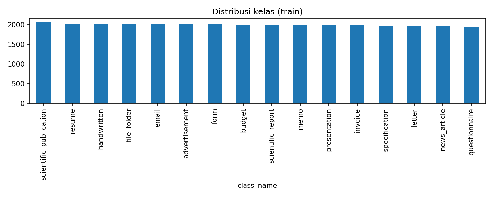
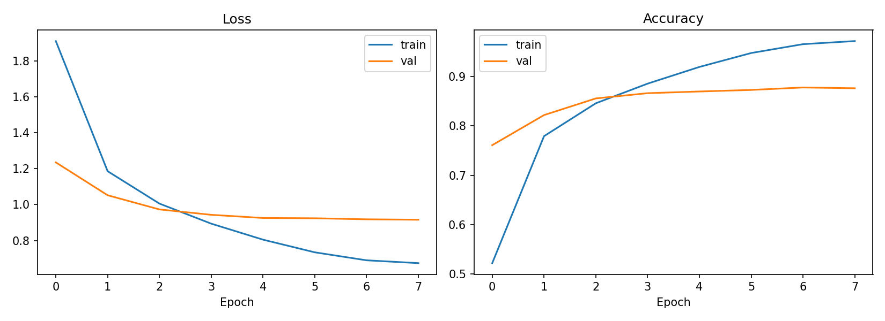
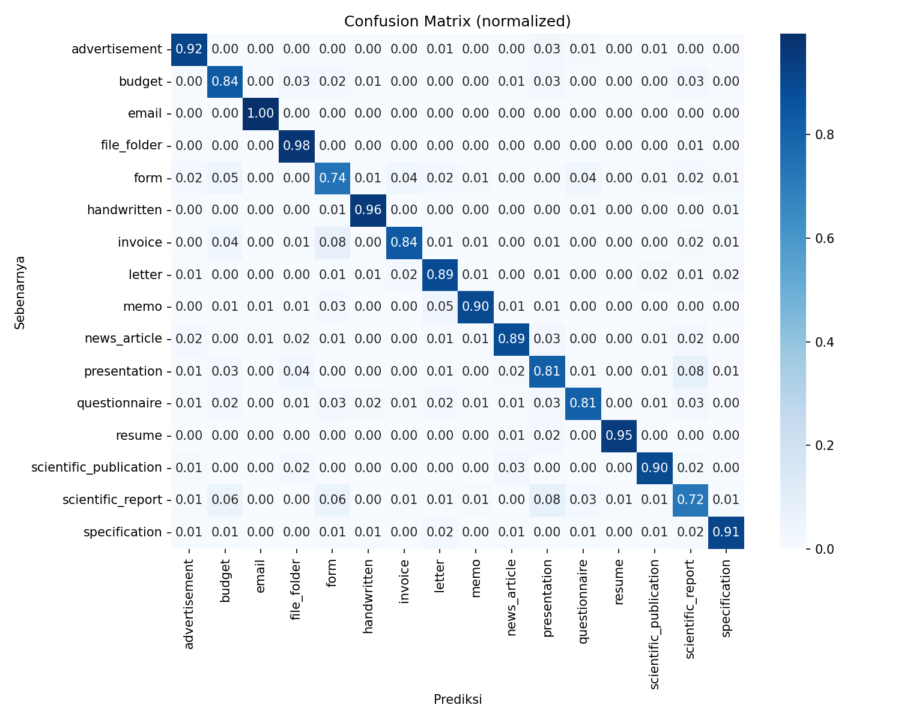

# Document Image Classification (Kaggle) - PyTorch

Klasifikasi halaman dokumen hasil scan ke dalam **16 kategori** (turunan benchmark RVL-CDIP)
menggunakan **fine-tuning model pretrained (ConvNeXt-Tiny, timm) dengan PyTorch**.
Tugas 2 - Supervised Machine Learning 2026.

- Kompetisi: https://www.kaggle.com/t/ec93bc56cc9842959bb6728723d23d29
- Metrik: Accuracy (leaderboard Kaggle)
- Public Score: **ISI_SKOR**  |  Val Accuracy: **ISI_VAL**

## Struktur Repository
```
├── README.md
├── .gitignore
├── requirements.txt
├── data/                 # dataset (TIDAK di-commit, lihat cara unduh)
├── checkpoint/           # bobot model (TIDAK di-commit)
├── notebooks/
│   ├── 01_eda.ipynb          # EDA + pre-resize gambar
│   ├── 02_training.ipynb     # training & evaluasi
│   └── 03_submission.ipynb   # inference (TTA) + submission.csv
├── scripts/
│   ├── preprocess.py     # cache gambar .tif -> .jpg 224x224
│   ├── dataset.py        # Dataset, transform, DataLoader
│   ├── model.py          # backbone timm pretrained
│   ├── train.py          # loop training/validasi, scheduler, AMP
│   ├── predict.py        # inference + TTA + pembuatan submission
│   └── utils.py          # seed, path data, plotting
├── submissions/submission.csv
└── reports/figures/      # class_distribution, sample_images, training_curve, confusion_matrix
```

## Cara Mengunduh Data
Data tidak disimpan di repo (4,86 GB). Pilih salah satu:
1. **Kaggle Notebook (disarankan):** buka kompetisi -> *Code -> New Notebook*; data tersedia di `/kaggle/input/...`.
2. **CLI:**
   ```bash
   pip install kaggle   # taruh kaggle.json di ~/.kaggle
   kaggle competitions download -c <slug-kompetisi> -p data/
   unzip data/*.zip -d data/
   ```
   Pastikan sudah menekan *Join Competition* dan menerima rules.

## Cara Menjalankan (Kaggle Notebook)
1. Buat notebook baru di halaman kompetisi, aktifkan **Accelerator GPU** dan **Internet On**.
2. Upload notebook dari folder `notebooks/` (*File -> Import Notebook*) lalu ganti `GANTI_USERNAME` pada `REPO_URL`.
3. Jalankan berurutan: `01_eda` -> `02_training` -> `03_submission`.
   (Jalankan dalam satu sesi, atau tambahkan output notebook 02 sebagai *Input* untuk notebook 03.)
4. Unduh `submission.csv` dari `/kaggle/working/` dan upload di tab *Submit Prediction*.

Lokal: `pip install -r requirements.txt`, lalu ubah `DATA_DIR`/`CACHE_DIR` pada notebook.

## Workflow
EDA -> Preprocessing (resize + cache) -> Split stratified 90/10 -> Fine-tuning -> Evaluasi (val, confusion matrix) -> Inference + TTA -> Submission.

## Laporan Interpretasi
> Lengkapi bagian ini dengan angka dan gambar dari hasil run kamu.

### 1. Hasil EDA
- 32.003 gambar train, 7.994 test, 16 kelas, distribusi hampir seimbang (~2000 per kelas) sehingga tidak diperlukan class weighting.
- Gambar berupa scan grayscale dengan ukuran beragam; semua di-resize ke 224x224 dan diubah ke 3 channel agar kompatibel dengan backbone pretrained.
- (Tambahkan: temuan menarik dari `reports/figures/sample_images.png`.)



### 2. Pemilihan Model
ConvNeXt-Tiny pretrained ImageNet dipilih karena fitur tekstur/tata letak dari pretrain ImageNet
dapat ditransfer ke dokumen, dan fine-tuning lebih cepat konvergen dan lebih akurat dibanding training dari nol.
(Tambahkan perbandingan dengan baseline lain bila ada, mis. EfficientNet-B0.)

### 3. Konfigurasi Training
| Hyperparameter | Nilai |
|---|---|
| Backbone | convnext_tiny |
| Input | 224x224 |
| Optimizer | AdamW (lr 2e-4, wd 0.05) |
| Scheduler | Warmup 1 epoch + cosine decay |
| Loss | CrossEntropy, label smoothing 0.1 |
| Epoch / Batch | 12 / 64 |
| Augmentasi | RandomAffine kecil, ColorJitter (tanpa flip) |
| Lainnya | Mixed precision, gradient clipping 1.0, TTA saat inference |

### 4. Hasil & Analisis



- Val accuracy terbaik: ISI_VAL; Public LB: ISI_SKOR.
- Kelas yang sering tertukar: (isi dari confusion matrix, mis. scientific_report vs scientific_publication karena tata letak mirip).
- Gap train vs val: (analisis overfitting dari training curve).

### 5. Keterbatasan & Perbaikan
- Resolusi 224 menghilangkan detail teks kecil; coba 288-384 atau model dokumen (mis. DiT).
- Ensemble beberapa backbone, training lebih panjang, atau stratified K-fold.
