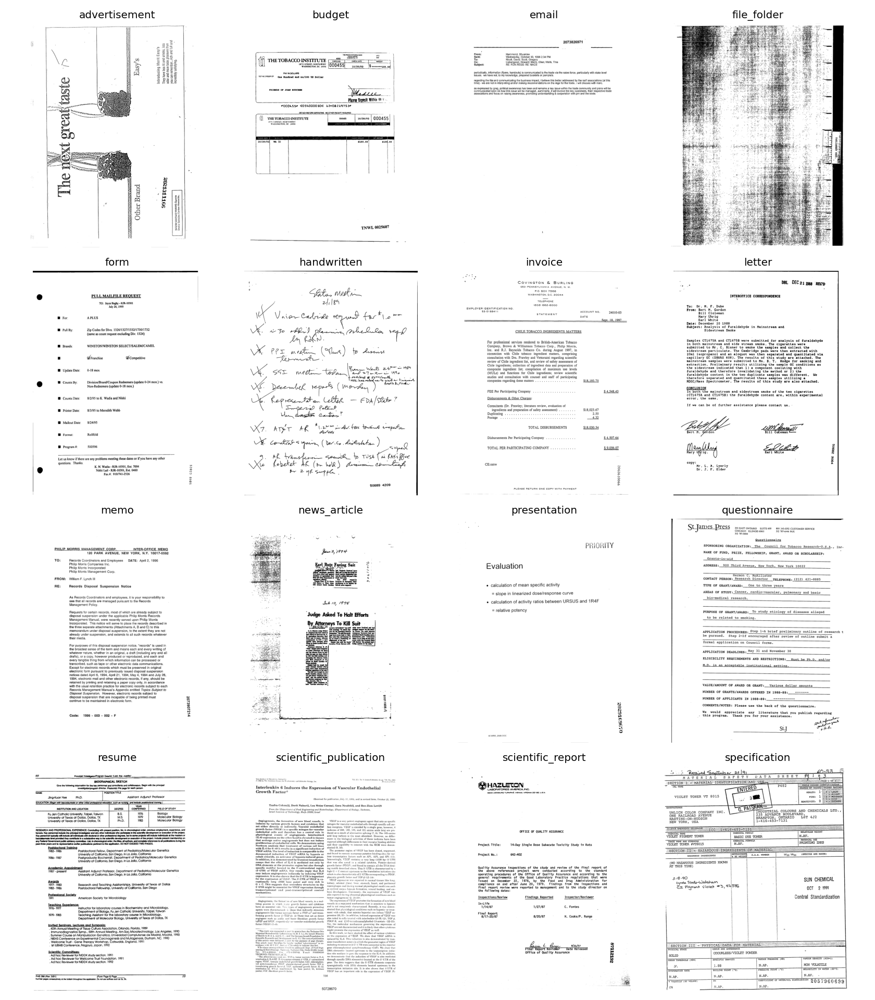

# Document Image Classification (Kaggle) - PyTorch

Klasifikasi halaman dokumen hasil scan ke dalam **16 kategori** (turunan benchmark RVL-CDIP)
menggunakan **fine-tuning model pretrained EfficientNet-B3 (timm) dengan PyTorch**.
Tugas 2 - Supervised Machine Learning 2026.

- Kompetisi: https://www.kaggle.com/t/ec93bc56cc9842959bb6728723d23d29
- Metrik: Accuracy (leaderboard Kaggle)
- Public Score: **0.87285** | Val Accuracy: **0.8779**

## Struktur Repository
```
├── README.md
├── .gitignore
├── requirements.txt
├── data/                 # dataset (TIDAK di-commit, lihat cara unduh)
├── checkpoint/           # bobot model (TIDAK di-commit)
├── notebooks/
│   ├── 01_eda.ipynb          # EDA + cache gambar (resize 224x224)
│   ├── 02_training.ipynb     # training & evaluasi
│   └── 03_submission.ipynb   # inference + submission.csv
├── scripts/
│   ├── __init__.py
│   ├── preprocess.py     # cache gambar .tif -> .jpg 224x224 grayscale
│   ├── dataset.py        # Dataset, transform, DataLoader
│   ├── model.py          # backbone timm pretrained
│   ├── train.py          # loop training/validasi, scheduler, AMP
│   ├── predict.py        # inference + pembuatan submission
│   └── utils.py          # seed, path data, plotting
├── submissions/submission.csv
└── reports/figures/      # class_distribution, sample_images, training_curve, confusion_matrix
```

## Cara Mengunduh Data
Data tidak disimpan di repo (4,86 GB). Pilih salah satu:
1. **Kaggle Notebook (disarankan):** buka kompetisi -> *Code -> New Notebook*; data tersedia di `/kaggle/input/competitions/document-image-classification-sd234504`.
2. **CLI:**
   ```bash
   pip install kaggle   # taruh kaggle.json di ~/.kaggle
   kaggle competitions download -c document-image-classification-sd234504 -p data/
   unzip data/*.zip -d data/
   ```
   Pastikan sudah menekan *Join Competition* dan menerima rules.

## Cara Menjalankan (Kaggle Notebook)
1. Buat notebook baru di halaman kompetisi, aktifkan **Accelerator GPU (T4)** dan **Internet On**.
2. Upload notebook dari folder `notebooks/` (*File -> Import Notebook*). Notebook otomatis meng-clone repo ini lewat `REPO_URL`.
3. Jalankan **01_eda** (cache gambar), lalu **02_training**. Training menghasilkan `checkpoint/efficientnet_b3_best.pt`.
4. Klik **Save Version -> Save & Run All (Commit)** pada notebook 02 dan tunggu selesai.
5. Di notebook **03_submission**, tambahkan output notebook 02 lewat *Add Input -> Notebook Output Files*, **restart session**, lalu jalankan semua sel. Jika checkpoint tidak terbaca, cek dengan `!find -L /kaggle/input -name "*.pt"` dan sesuaikan `CKPT`.
6. Unduh `submission.csv` dari `/kaggle/working/` lalu upload di tab *Submit Prediction*.

Lokal: `pip install -r requirements.txt`, lalu ubah `DATA_DIR`/`CACHE_DIR` pada notebook.

## Workflow
EDA -> Preprocessing (resize + cache) -> Split stratified 90/10 -> Fine-tuning -> Evaluasi (val, confusion matrix) -> Inference -> Submission.

## Laporan Interpretasi

### 1. Hasil EDA
- Data train 32.003 gambar, test 7.994 gambar, 16 kelas. Distribusi kelas sangat seimbang (1.948 sampai 2.056 gambar per kelas), sehingga tidak diperlukan class weighting atau resampling, dan accuracy valid sebagai metrik.
- Ukuran gambar asli seragam di tinggi (1000 px) dengan lebar 713-872 px (rata-rata sekitar 770 px). Semua gambar di-resize ke 224x224 grayscale (JPEG cache) lalu diubah ke 3 channel agar kompatibel dengan backbone pretrained. Resize ke persegi mengubah rasio aspek dan mengecilkan teks kecil.
- Dari 32.003 gambar train, 1 gambar gagal di-cache (peringatan *Corrupt EXIF data*); test semuanya berhasil (7.994).
- Contoh gambar menunjukkan kualitas scan yang sangat beragam: `file_folder` dan `news_article` penuh noise/bintik hitam, `handwritten` berupa tulisan tangan, `presentation` berupa slide dengan sedikit teks, dan sebagian halaman (mis. contoh `advertisement`) terotasi 90 derajat. Kelas dengan tata letak khas seperti `email`, `resume`, `handwritten`, dan `file_folder` diduga mudah dikenali, sedangkan dokumen kantor berteks seperti `form`, `invoice`, `budget`, dan `questionnaire` memiliki tata letak yang mirip satu sama lain.
- `scientific_publication` (jurnal dua kolom) dan `scientific_report` (laporan satu kolom dengan kop dan tabel) tampak berbeda secara visual.




### 2. Pemilihan Model
EfficientNet-B3 pretrained ImageNet (timm) dipilih karena fitur tekstur dan tata letak dari pretrain ImageNet dapat ditransfer ke dokumen, dan fine-tuning lebih cepat konvergen dibanding training dari nol. Sebagai pembanding, model awal ConvNeXt-Tiny memperoleh public score 0.86783, sedangkan EfficientNet-B3 memperoleh 0.87285.

### 3. Konfigurasi Training
| Hyperparameter | Nilai |
|---|---|
| Backbone | efficientnet_b3 (pretrained) |
| Input | 224x224 |
| Optimizer | AdamW (lr 2e-4, wd 0.05) |
| Scheduler | Warmup + cosine decay |
| Loss | CrossEntropy, label smoothing 0.1 |
| Epoch / Batch | 8 / 64 |
| Split | Stratified 90% train / 10% validasi |
| Augmentasi | RandomAffine kecil, ColorJitter (tanpa flip, agar teks tidak terbalik) |
| Regularisasi | Dropout 0.2, stochastic depth (drop path) 0.1 |
| Lainnya | Mixed precision, gradient clipping 1.0 |

### 4. Hasil & Analisis


**Kurva training.** (Sumbu x pada grafik dimulai dari 0, sehingga titik 6 = epoch ke-7.)
- Val accuracy terbaik **0.8779** (epoch 7), public leaderboard **0.87285**. Skor leaderboard sedikit di bawah val acc, wajar karena public score dihitung dari sebagian data test.
- Pada epoch awal, val accuracy lebih tinggi dari train (0.76 vs 0.52 di epoch 1), karena metrik train dihitung dengan augmentasi, dropout, dan label smoothing aktif, sedangkan validasi tidak. Kedua kurva berpotongan sekitar epoch 3.
- Setelah itu train accuracy terus naik sampai 0.972 dan train loss turun ke 0.67, sedangkan val accuracy hanya naik tipis dan mendatar di 0.87-0.878 sejak epoch 5, dengan val loss bertahan sekitar 0.92. Gap sekitar 9,5 poin ini menandakan **overfitting**: model mulai menghafal data train dan tambahan epoch tidak lagi meningkatkan generalisasi. Checkpoint diambil dari epoch dengan val acc tertinggi.

**Confusion matrix (dinormalisasi per kelas asli).**
- Kelas terbaik: `email` (1.00), `file_folder` (0.98), `handwritten` (0.96), `resume` (0.95). Kelas ini punya tata letak atau tampilan yang khas.
- Kelas terlemah: `scientific_report` (0.72), `form` (0.74), `presentation` (0.81), dan `questionnaire` (0.81).
- Kesalahan terbesar: `scientific_report` ↔ `presentation` (0.08 di kedua arah), `invoice` salah jadi `form` (0.08), `scientific_report` salah jadi `budget` dan `form` (masing-masing 0.06), `form` salah jadi `budget` (0.05), serta `memo` salah jadi `letter` (0.05).
- Interpretasi: pada resolusi 224x224 teks kecil tidak terbaca, sehingga model hanya mengandalkan tata letak global. Kelas dengan tata letak generik (`form`, `invoice`, `budget`, `questionnaire`, `memo` vs `letter`) sulit dipisahkan. `scientific_report` bervariasi (halaman sampul, tabel, formulir laboratorium), sehingga mirip dengan beberapa kelas lain dan menjadi kelas dengan recall terendah.

### 5. Keterbatasan & Perbaikan
- Resolusi 224x224 dan resize tanpa mempertahankan rasio aspek menghilangkan detail teks kecil, padahal kesalahan terbesar terjadi pada kelas yang hanya dibedakan oleh isi teks. Coba resolusi 288-384, padding untuk menjaga rasio, atau model khusus dokumen (mis. DiT, LayoutLM).
- Overfitting dapat dikurangi dengan augmentasi lebih kuat, mixup/cutmix, atau regularisasi tambahan.
- Ensemble beberapa backbone (EfficientNet-B3 + ConvNeXt-Tiny) dan training memakai seluruh data (tanpa hold-out 10%) berpotensi menaikkan akurasi.
